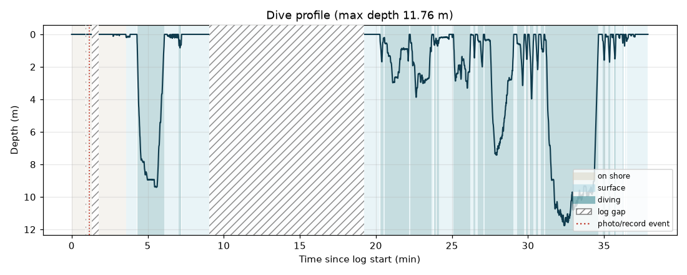
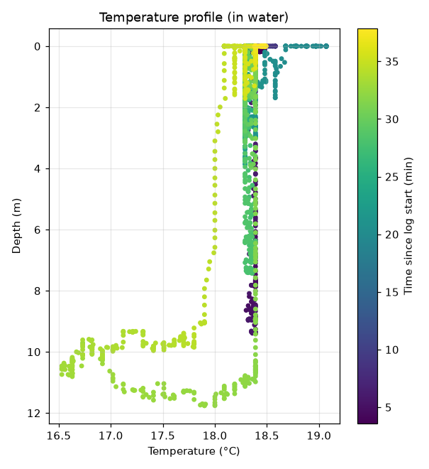

# FIFISH E-GO ROV Log Analysis

Python notebook to analyse the **ROV Log** files of a QYSEA **FIFISH E-GO** underwater drone (tethered ROV):
dive profiles, water temperature against depth, orientation/stability and a comparison of several dives.All data contained in the log file can be visualized with these plots.

## What the notebook does

For one selected log it produces:

| Output | Content |
|---|---|
| `1_dive_profile.png` | depth over time, coloured by phase (on shore / surface / diving), gaps and photo events marked |
| `2_temperature_time.png` | ROV temperature sensor over time, with depth |
| `3_temperature_profile.png` | temperature against depth (in water) |
| `4_attitude.png`, `5_heading_rose.png` | pitch, roll, heading |
| `6_speed_stability.png` | vertical speed and stability (a proxy for how steady the video is) |
| `7_time_per_depth.png` | time spent in each depth layer |
| `dive_table.csv`, `temperature_per_depth_bin.csv` | one row per dive; temperature statistics per metre of depth |
| `dive_summary.json`, `rov_log_clean.csv` | key numbers and the cleaned time series |

With `COMPARE_ALL = True` it also overlays all logs in `data/raw/` in `outputs/compare/`.

### Example (log of 20 October 2026, Lake Zurich)




## Data

The logs are exported from the FIFISH app:
**Help → ROV Log → switch on *Log Collection* → *Connect* and dive → *Export log* (format JSON)**

Turn the log collection on **before** the dive. After the dive, immediately export the file and delete the log memory on the FIFISH app before the next dive. 

A log file is a list of records with `type`, `timestamp` (UTC, milliseconds) and `payload`:

| Record type | Fields | Note |
|---|---|---|
| `depth` | `depth` (m), `temperature` (°C) | temperature is measured inside the ROV |
| `attitude` | `yaw`, `pitch`, `roll` (°) | `yaw` = heading, 0° = north |
| `water_sensor` | `ph`, `salt`, `ntu`, `doValue` | all 0 unless the water-quality sensor accessory is attached |
| `photo` | `photo_type` | button press, useful to synchronise with the video |

The raw logs are **not included** in this repository (see `.gitignore`). Copy your own `ROV-Log*.json` files into `data/raw/`.


## Setup

You need [conda](https://docs.anaconda.com/miniconda/) (or Miniconda) and, to run the notebook, VS Code with the
*Python* and *Jupyter* extensions (or JupyterLab).

```bash
git clone https://github.com/<your-username>/fifish-rov-log-analysis.git
cd fifish-rov-log-analysis
conda env create -f environment.yml
conda activate fifish-env
```

## How to run

1. Copy your log files into `data/raw/`.
2. Open `notebooks/fifish_log_analysis.ipynb` (VS Code: select the kernel **fifish-env**).
3. In section 1.2 set `LOG_ID` to a unique part of the file name, e.g. the number at the end (`"1020111815"`).
4. Run all cells (*Restart & Run All*). Results appear in `outputs/log_<ID>/`.

To analyse another log, change `LOG_ID` and run again from the top.

## Limitations

- The temperature sensor is inside the ROV, uncalibrated and slow to respond (minutes). Compare it with an independent
  reference (CTD instrument,sensors, lake model, satellite surface temperature) before drawing conclusions.
- Without the optional GPS module the logs contain **no coordinates**. Difficult to determine where the ROV is located.
- Water entry is detected automatically (temperature drop or first dive); it can be set by hand with `WATER_ENTRY_S`
